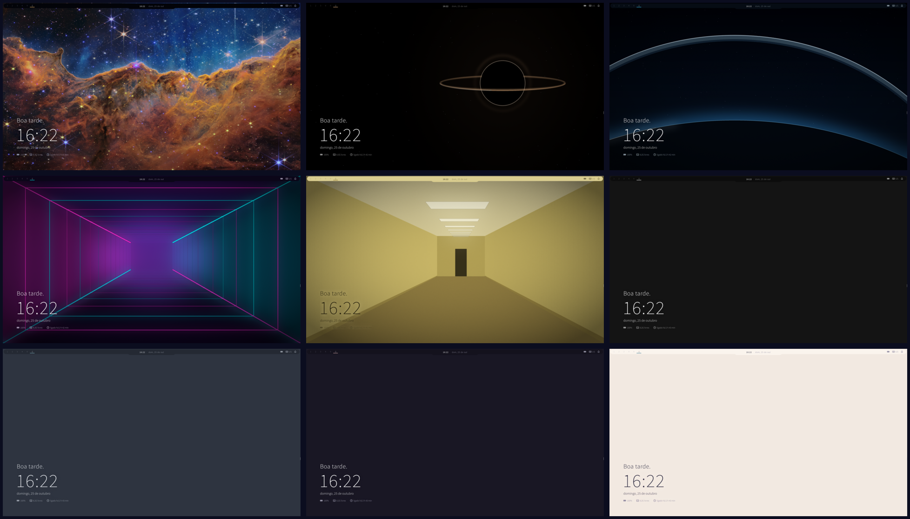
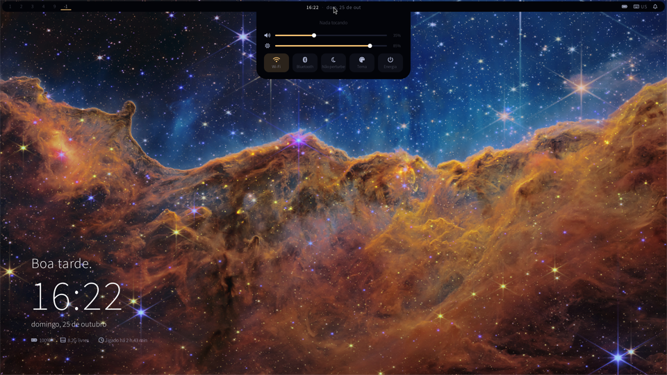
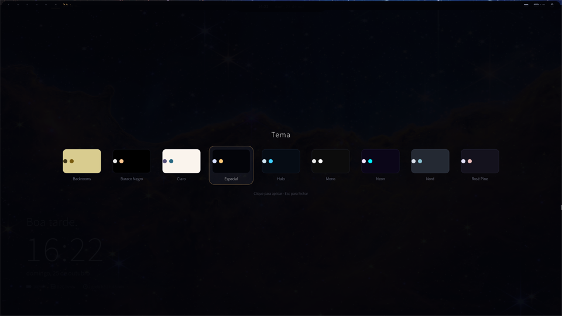
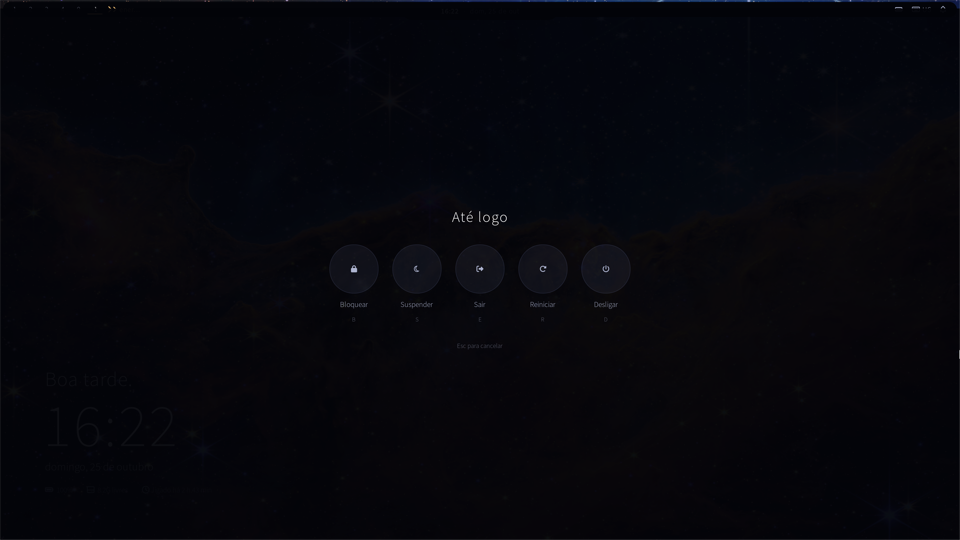

# sway_ricing

Ricing minimalista para o [sway](https://swaywm.org) no openSUSE: **9 temas que trocam ao vivo**, uma *dynamic island* feita em [eww](https://github.com/elkowar/eww), avisos rápidos de volume e brilho, tela de energia e um "bem-vindo" na área de trabalho.



> Da esquerda para a direita, de cima para baixo: Espacial, Buraco Negro, Halo, Neon, Backrooms, Mono, Nord, Rosé Pine e Claro.

## O que tem

- **Seletor de temas** (`Win+Shift+T`): troca na hora as cores da Waybar, da island, do wofi, das bordas das janelas, do terminal, o wallpaper e o modo claro/escuro dos apps GTK. Cada tema é um arquivo `.toml` com 6 cores.
- **Dynamic island**: uma aba que continua a barra, mostrando hora e data. Passando o mouse, ela desce com:
  - música (capa, título, artista e controles);
  - volume e brilho;
  - botões de Wi-Fi, Bluetooth, Não perturbe, Tema e Energia.
- **Avisos rápidos**: volume, brilho e troca de teclado aparecem por 1,5 s no lugar da hora.
- **Boas-vindas** na área de trabalho: saudação, relógio grande, data, bateria, espaço livre e tempo ligado.
- **Tela de energia** (`Win+Shift+E`): bloquear, suspender, sair, reiniciar e desligar, pelo mouse ou pelas teclas B/S/E/R/D.
- **Waybar** só com o essencial e um visualizador de áudio (cava) que só aparece quando há som tocando.
- **Menus no wofi** para Wi-Fi e Bluetooth (botão direito nos botões da island).
- **Teclado US ↔ BR (ABNT2)** com `Win+Espaço`, pensado para teclado físico americano.

| Painel da island | Seletor de temas | Tela de energia |
|---|---|---|
|  |  |  |

## Temas

| Tema | Estilo |
|---|---|
| **Espacial** | Azul-escuro com destaque dourado e foto do telescópio James Webb |
| **Buraco Negro** | Preto absoluto e luz quente de um disco de acreção |
| **Halo** | Futurista: aço azul, HUD ciano e um anel orbital sobre um planeta |
| **Neon** | Cyberpunk liminar: corredor vazio com neon magenta e ciano |
| **Backrooms** | Espaço liminar amarelado, luz fluorescente (tema claro) |
| **Mono** | Só preto e cinzas |
| **Nord** | Cinza-azulado frio |
| **Rosé Pine** | Escuro arroxeado com rosa suave |
| **Claro** | Papel off-white e texto grafite |

### Criar um tema

Copie um arquivo de `~/.config/temas/` e troque as cores. Ele aparece no seletor sozinho.

```toml
nome = "Meu tema"
esquema = "dark"                      # "dark" ou "light" (apps GTK)
papel = "~/.local/share/backgrounds/meu.png"   # imagem ou uma cor, ex.: "#141414"

[cores]
fundo    = "#0c0c0c"   # barra, island e menus
tinta    = "#ffffff"   # base das superfícies e contornos (usada translúcida)
texto    = "#e6e6e6"
brilho   = "#ffffff"   # texto em destaque
destaque = "#88c0d0"
alerta   = "#bf616a"

[terminal]             # opcional
fundo  = "#0c0c0c"
texto  = "#d4d4d4"
normal = ["#1c1c1c", "#c27a7a", "#9db48f", "#c9b27c", "#8aa1b8", "#a891b0", "#8fb2b0", "#d4d4d4"]
claro  = ["#5a5a5a", "#d08f8f", "#b0c7a2", "#dcc58f", "#9db4cb", "#bba4c3", "#a2c5c3", "#ffffff"]
```

Pelo terminal: `~/.config/temas/tema <nome>` aplica um tema e `~/.config/temas/tema lista` lista os disponíveis.

## Atalhos

| Atalho | Ação |
|---|---|
| `Win+D` | Lançador de apps (wofi) |
| `Win+Enter` / `Win+T` | Terminal (alacritty) |
| `Win+S` / `Win+F` | Spotify / Firefox |
| `Win+Espaço` | Alterna teclado US ↔ BR |
| `Win+Shift+T` | Seletor de temas |
| `Win+Shift+E` | Tela de energia |
| `Win+Shift+F` | Tela cheia |
| `Win+Shift+S` | Layout empilhado |
| `Win+Ctrl+Espaço` | Alterna foco entre janelas lado a lado e flutuantes |
| `Ctrl+Shift+T` / `Ctrl+Shift+W` | Novo terminal / fechar terminal (alacritty) |
| Teclas de volume e brilho | Aplicam e mostram o aviso na island |

Os demais atalhos são os padrões do sway.

## Instalação

### Dependências (openSUSE)

```sh
sudo zypper in sway waybar eww wofi alacritty cava playerctl pamixer brightnessctl \
    SwayNotificationCenter swaylock swayidle grim jq NetworkManager bluez \
    adobe-sourcesanspro-fonts fontawesome-fonts dejavu-fonts
# Só para regenerar os wallpapers:
sudo zypper in python313-Pillow python313-numpy
```

A config parte do **openSUSEway**, a sessão sway do openSUSE, e inclui `/etc/sway/config.d/*.conf`. Em outras distros, remova essa linha do final de `config/sway/config` e confira o lançador, o swaync e o wob, que vêm de lá. O script de temas precisa de Python 3.11 ou mais novo, por causa do `tomllib`.

### Instalar

```sh
git clone https://github.com/<seu-usuario>/sway_ricing.git
cd sway_ricing
./install.sh            # ou ./install.sh neon, ./install.sh halo...
```

O instalador copia tudo para `~/.config`, guarda um backup do que já existia em `~/.config/sway_ricing-backup-<data>` e aplica o tema. Depois, recarregue o sway com `Win+Shift+C`.

## Estrutura

```
config/
├── sway/config, sway/config.d/tema.conf   atalhos, island, avisos, energia
├── waybar/                                barra, estilo, menus (wofi) e cava
├── wofi/                                  lançador
├── eww/eww.yuck, eww.scss, scripts/       island, avisos, energia, temas, boas-vindas
├── alacritty/alacritty.toml               terminal (importa as cores do tema)
└── temas/*.toml, tema, gerar_wallpapers.py
wallpapers/                                wallpapers (veja CREDITOS.md)
extras/bolhas/                             wallpaper animado em shader (C + GLSL)
extras/capturar_prints.sh                  refaz os prints deste README
```

Os estilos têm um bloco `TEMA-INICIO … TEMA-FIM` que o script de temas reescreve. Os arquivos `config/sway/config.d/cores.conf` e `config/alacritty/cores.toml` são gerados por ele.

## Extras: wallpaper animado

`extras/bolhas/` é um wallpaper animado (bolhas, ondas e estrelas) desenhado por um shader GLSL na camada de fundo do sway, limitado a 30 FPS e pausado sozinho quando a tela está coberta. Para compilar, é preciso `wayland-devel wayland-protocols-devel Mesa-libEGL-devel Mesa-libGLESv2-devel`:

```sh
cd extras/bolhas && make && ./bolhas    # -f fps, -d densidade, -s shader.frag
```

## Notas do eww (para quem for mexer)

- O eww dá a cada janela uma classe CSS com o nome dela. Uma classe igual ao nome de uma janela, como `.ilha` numa janela `ilha`, também estiliza a janela inteira, e os cantos arredondados saem pretos.
- Pelo mesmo motivo, na Waybar o fundo arredondado fica em `window#waybar > box`, e não na janela.
- Comandos de clique do eww são interrompidos depois de cerca de 200 ms. Ações longas precisam rodar em segundo plano (`comando &`).
- No Wayland, janelas do eww não encolhem. Por isso a island fechada tem tamanho fixo e o painel é uma segunda janela.

## Licença

[MIT](LICENSE). O wallpaper `carina-webb.jpg` é de NASA, ESA, CSA e STScI, sob [CC BY 4.0](https://creativecommons.org/licenses/by/4.0/) ([créditos](wallpapers/CREDITOS.md)).
